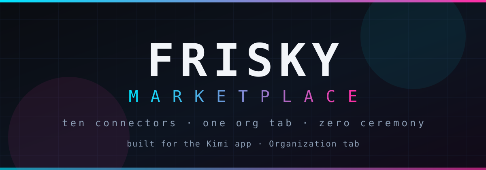
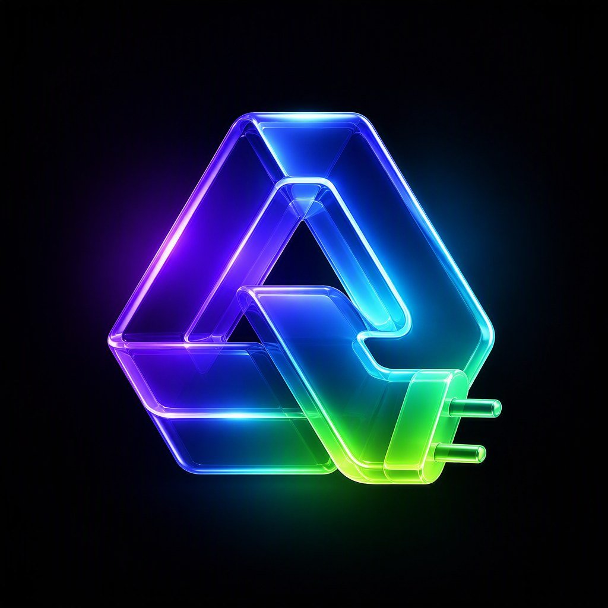

<div align="center">



<!-- BEGIN GENERATED COUNT -->

<!-- END GENERATED COUNT -->


<!-- BEGIN GENERATED TAGLINE -->
**12 connectors · one org tab · zero ceremony**
<!-- END GENERATED TAGLINE -->

Personal plugin marketplace for the **Kimi** app. Add this repo in the
Directory's **Organization** tab — the app re-fetches it periodically, so
**every push here is a release**.

</div>

---

## The Roster

<!-- BEGIN GENERATED ROSTER -->
| # | | Plugin | What it wires into your chats | Category |
|---|-|--------|-------------------------------|----------|
| 01 |  | [**ChatPRD**](./chatprd) | Push PRDs and FriskyClaw digests into ChatPRD | `PRODUCTIVITY` |
| 02 |  | [**Composio Connector**](./composio-connector) | 在 Kimi 里使用 Composio Connector | `PRODUCTIVITY` |
| 03 |  | [**Convex Connector**](./convex-connector) | 在 Kimi 里直连你的 Convex 项目 | `DEVELOPER_TOOLS` |
| 04 |  | [**Folios**](./folios) | 在 Kimi 里使用 Folios | `PRODUCTIVITY` |
| 05 |  | [**Framer**](./framer) | Diseña, edita y publica sitios Framer desde Kimi | `PRODUCTIVITY` |
| 06 |  | [**Frisky Dev MCP**](./friskydev-mcp) | Use Frisky Dev MCP in Kimi — 15 specialist operators with shared memory | `PRODUCTIVITY` |
| 07 |  | [**Render**](./render) | 在 Kimi 里管理 Render 云服务 | `DEVELOPER_TOOLS` |
| 08 |  | [**Sentry Connector**](./sentry-connector) | 在 Kimi 里使用 Sentry Connector | `DEVELOPER_TOOLS` |
| 09 |  | [**Cloudflare Connector**](./cloudflare-connector) | 在 Kimi 里使用 Cloudflare Connector | `DEVELOPER_TOOLS` |
| 10 |  | [**n8n Connector**](./n8n-connector) | 在 Kimi 里使用 n8n Connector | `PRODUCTIVITY` |
| 11 |  | [**Perplexity**](./perplexity) | Search and reason with Perplexity inside sessions | `PRODUCTIVITY` |
| 12 |  | [**Magic Patterns**](./magic-patterns) | Prototype and iterate UI with Magic Patterns | `PRODUCTIVITY` |
<!-- END GENERATED ROSTER -->

## Supported App Versions

Compatibility refers to the **Kimi app version**, not the plugin's own
`version` in `kimi.plugin.json`. No app versions have been verified in this
repository yet. **Not yet verified** means support is unknown, not that all
versions are supported or that the plugin is incompatible.

<!-- app-compatibility:start -->
| Plugin | Supported Kimi app versions |
|--------|-----------------------------|
| `chatprd` | Not yet verified |
| `cloudflare-connector` | Not yet verified |
| `composio-connector` | Not yet verified |
| `convex-connector` | Not yet verified |
| `folios` | Not yet verified |
| `framer` | Not yet verified |
| `friskydev-mcp` | Not yet verified |
| `magic-patterns` | Not yet verified |
| `n8n-connector` | Not yet verified |
| `perplexity` | Not yet verified |
| `render` | Not yet verified |
| `sentry-connector` | Not yet verified |
<!-- app-compatibility:end -->

Maintainers: after checking a plugin on a released Kimi app version, replace
its `null` in `app-compatibility.json` with the exact verified version labels
(for example, `["1.2.3", "1.3.0"]`; these are illustrative, not support claims).
Record the tested versions and results in the PR. This file is repository-owned
documentation metadata, not a native Kimi manifest field or an install-time
compatibility gate. Add an entry for each new indexed plugin.

Run `python3 scripts/app_compatibility.py` and replace the marked table above
with its output. Verify with:

```bash
python3 -m unittest discover -s tests -v
python3 scripts/app_compatibility.py --check
git diff --check
```

## Install

1. Open the Kimi app → **Directory** → **Organization** tab
2. Paste this repo's URL:
   `https://github.com/FriskyDevelopments/frisky-marketplace`
3. Install plugins from the org marketplace as they appear

If the catalog or a plugin does not work, see the
[install troubleshooting guide](./docs/install-troubleshooting.md).

## Publish a New Plugin

```bash
# 1. drop the plugin folder at the repo root
cp -R ~/path/to/my-plugin ./my-plugin

# 2. add one entry to plugins.json
#    { "name": "my-plugin", "path": "./my-plugin", ... }

# 3. add an icon (used by the README roster + the app)
#    ./my-plugin/icon.svg  (or icon.png)

# 4. regenerate the roster and count, then run the marketplace checks
.venv/bin/python -m scripts.generate_roster
.venv/bin/python -m unittest discover -s tests -v
#    then push — the app picks it up on its next fetch
git add -A && git commit -m "add my-plugin" && git push
```

`plugins.json` is the native Kimi index — entries point at in-repo folders
(`path`) or external repos (`url`), with optional `description`, `category`,
and `owner` metadata.

## Categories and naming

- Use `DEVELOPER_TOOLS` for infrastructure, backend, and observability plugins;
  use `PRODUCTIVITY` for workflow, design, research, and collaboration plugins.
  Keep the index `category`, manifest `interface.category`, and roster identical.
- Plugin IDs (`name`) are lowercase kebab-case and must match the folder name
  and manifest `name`. Existing IDs and paths are stable install identifiers;
  do not rename them just to add or remove `-connector` or `-mcp` suffixes.
- Use the manifest `interface.displayName` as the roster label, preserving brand
  spelling and capitalization (for example, `ChatPRD` and `n8n Connector`).
  IDs belong in paths and configuration, not user-facing roster labels.

Check these conventions without installing dependencies or contacting MCP servers:

```bash
python3 -B -m unittest discover -s tests -v
git diff --check
```

## Marketplace checks

```bash
python3 -m venv .venv
.venv/bin/python -m pip install -r requirements-test.txt
.venv/bin/python -m unittest discover -s tests -v
.venv/bin/python -m scripts.generate_roster --check
```

Every `kimi.plugin.json`, including unindexed plugins, is validated against the
checked-in `schemas/plugin-manifest.schema.json`. This is the repository's
offline contract, not a copy of the upstream Kimi schema. It checks known fields
while allowing extensions and existing category labels. CI runs the same tests;
it does not connect to MCP servers or deploy anything.

The roster, count badge, and connector tagline are generated from `plugins.json`
(in index order), using local manifest short descriptions and icons when present.
Run `.venv/bin/python -m scripts.generate_roster` after changing the index or those
manifest fields. Tests reject stale generated content; other README sections stay
hand-maintained. External `url` entries do not require a checkout.

Skill checks require each declared skills directory to contain skill folders with
nonempty `SKILL.md` files. Local inline/image and reference-style Markdown links
must resolve within the plugin; remote links are not fetched. A `sessionStart.skill`
must match a declared skill folder.

Index compatibility tests cover the native `{ "name": ..., "plugins": [...] }`
shape, exactly one local `path` or external HTTP(S) `url` per entry, optional
metadata (including multilingual descriptions and existing category labels),
unique plugin names/local paths, and matching local manifest names. Unknown
metadata remains allowed for forward compatibility.

## Layout

```
frisky-marketplace/
├── assets/
│   └── banner.svg        ← this README's hero
├── plugins.json          ← the index (name: "frisky")
├── README.md
└── <plugin>/             ← one folder per plugin:
    ├── kimi.plugin.json  ← manifest (name, version, interface, mcpServers)
    ├── icon.svg/png/jpg  ← roster + app icon
    └── skills/           ← optional skill instructions (some plugins)
```

## Upstream MCP versions

Local MCP launch packages must use exact versions, not bare package names,
tags (`latest`), or ranges. Convex is pinned to `convex@1.45.0` in both
`convex-connector/kimi.plugin.json` and `convex-connector/.mcp.json`; update
both together when reviewing an upstream upgrade. This pins the launch
package, not its transitive dependencies.

The only current exception is Framer's `framer-mcp-server`: the public npm
registry returned HTTP 404 on 2026-10-03, so no published version could be
verified. Its existing launch declaration is unchanged (and may fail to
install). Once a release is available, verify its compatibility, pin that
exact version in the manifest, update the skill's launch example, and remove
the exception from the test. Do not invent a version or substitute another
package without reviewing compatibility.

Hosted HTTP MCP endpoints are provider-managed; this repository cannot pin
their server binaries. Their URLs are unchanged, rather than adding invented
version paths or query parameters.

Run the offline regression tests with:

```bash
python3 -m unittest discover -s tests -v
```

For a concrete read-only upstream check, run `npm view convex@1.45.0 version`
(expected: `1.45.0`) and `npm view framer-mcp-server versions --json`
(currently expected: `E404`). Neither command launches an MCP or deploys.

---

<div align="center">
<sub>frisky developments · wired for friskypup</sub>
</div>


## Claude, Grok, and Mistral

See [client setup and validation](docs/CLIENT_SETUP.md) for the three Frisky MCP connectors, authentication, and release checks. The Kimi catalog above is preserved.
